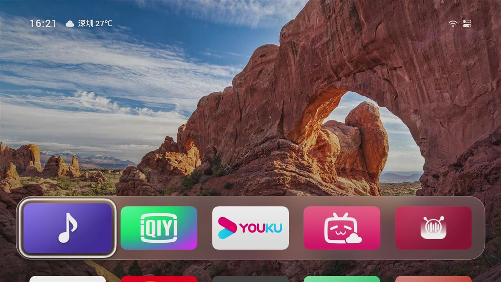
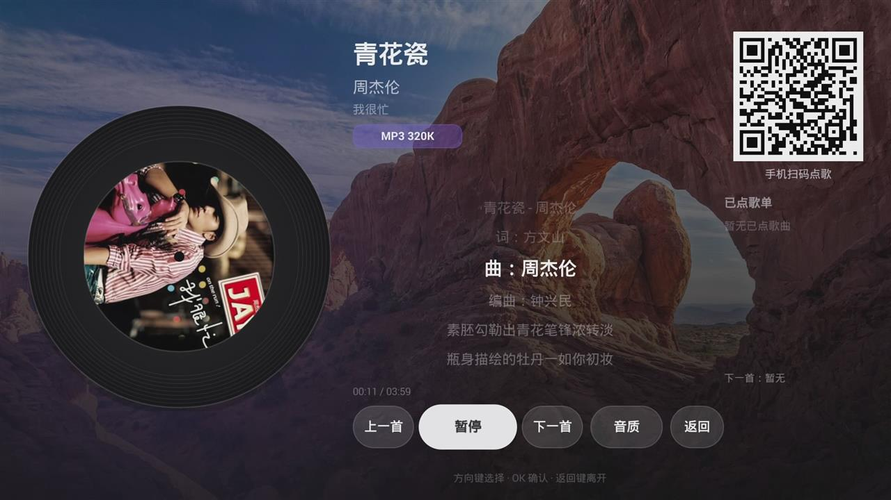
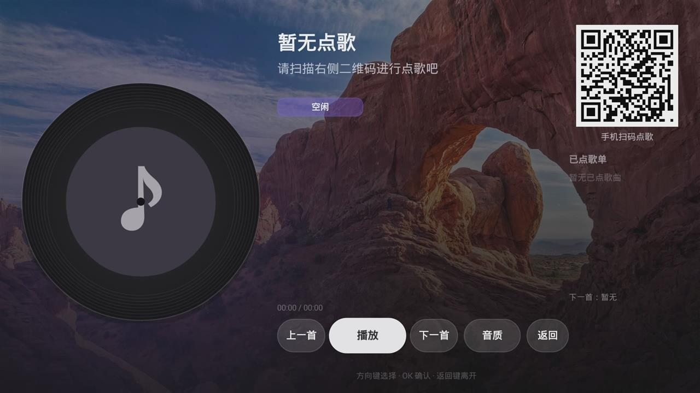
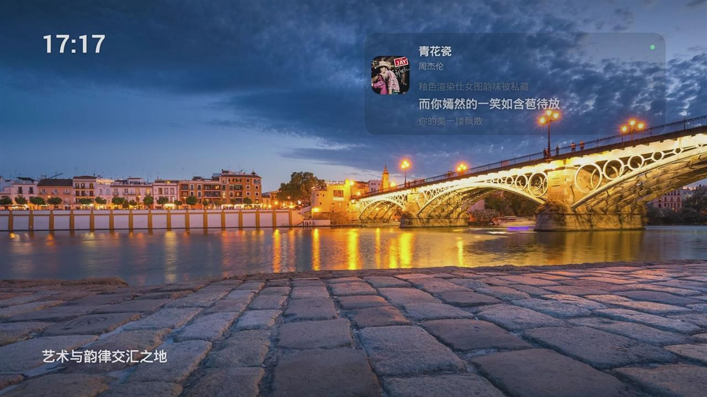
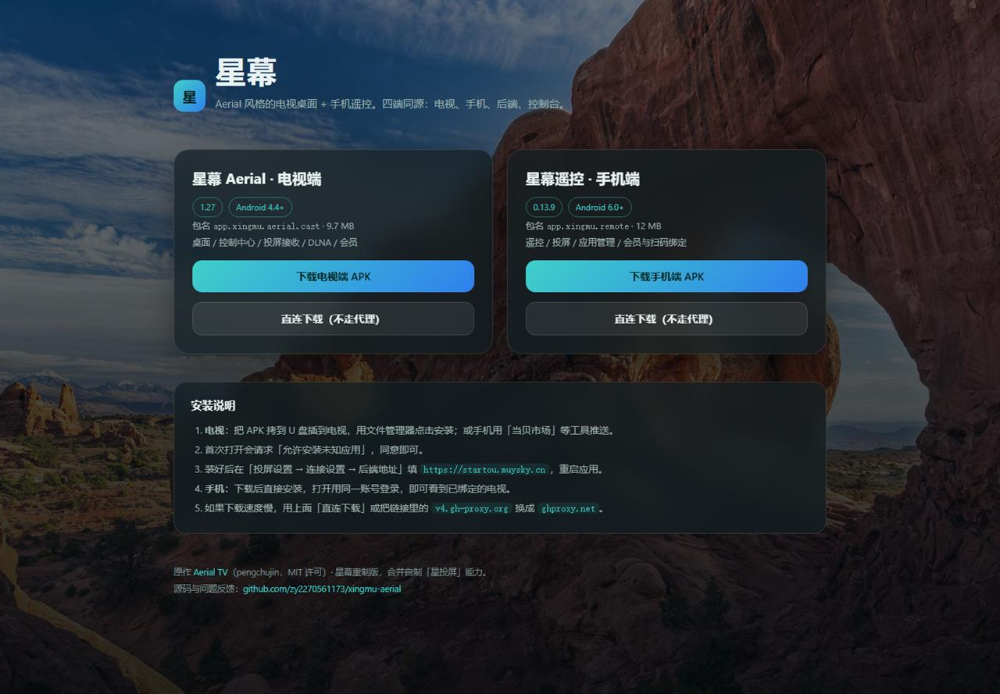
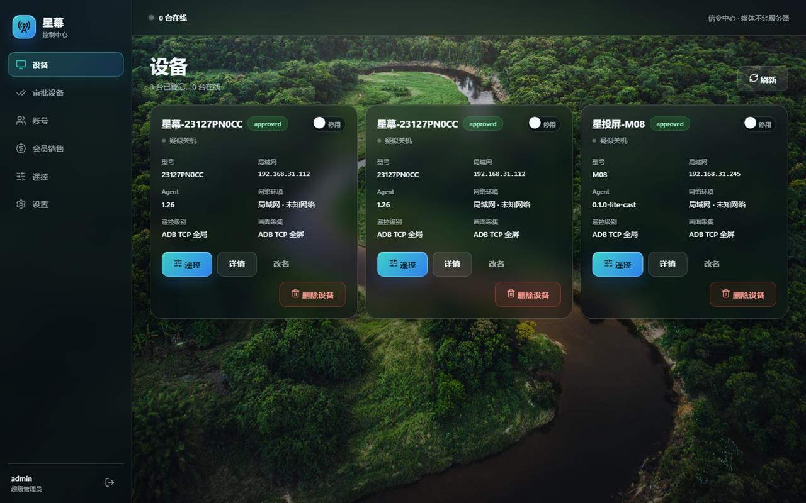
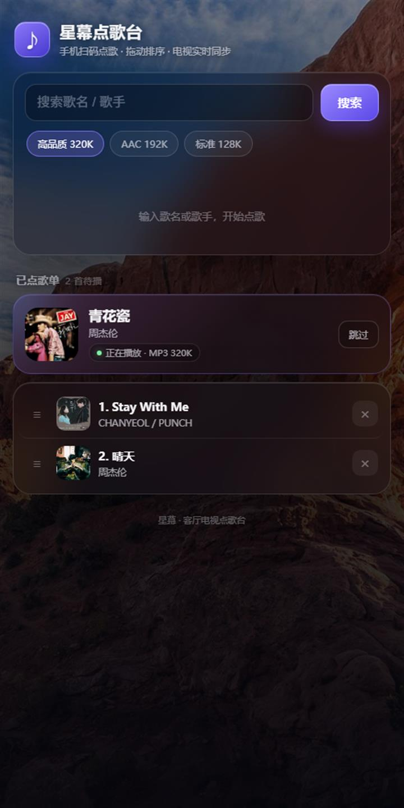
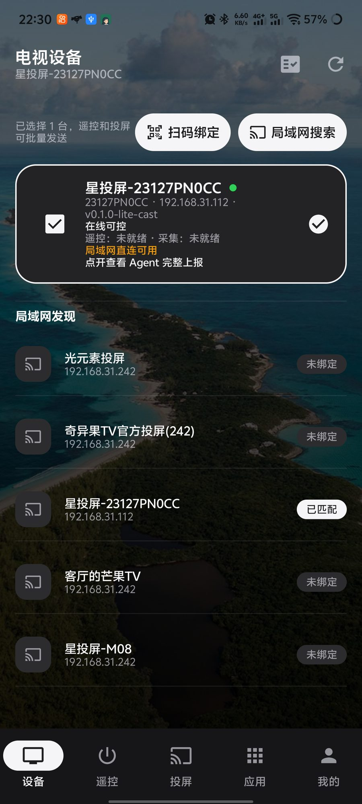
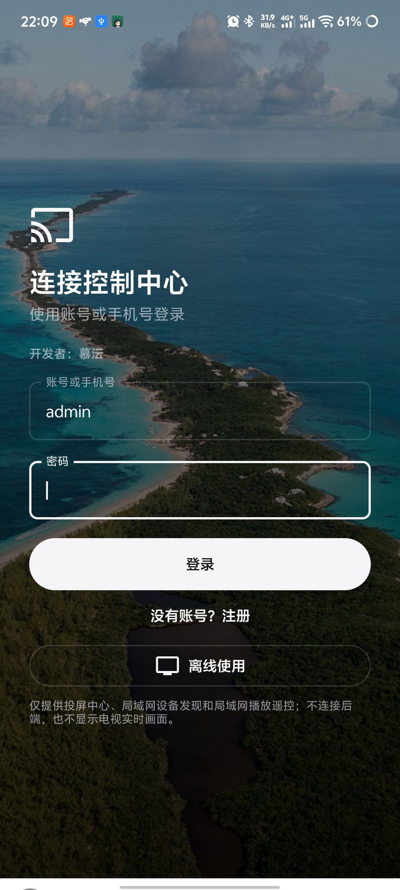
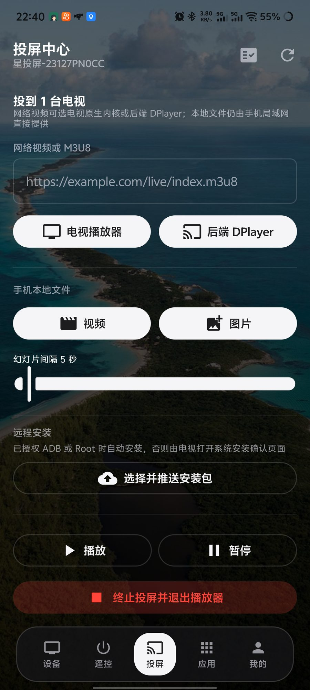

# 星幕 · Xingmu

Aerial 风格的电视桌面 **星幕 Aerial**，配一套手机遥控 **星幕遥控**、后端与 Web 控制台。
四端同仓：电视、手机、后端、前端；另带一个可直接扫码使用的**内置点歌台**。

线上地址：<https://startou.muysky.cn/>（落地页）· <https://startou.muysky.cn/admin>（控制台）

## 功能

### 电视端 · 星幕 Aerial（`app.xingmu.aerial`）

- Aerial 桌面：磁贴、文件夹、控制中心（音量/亮度/信号源/网络/设置）、Bing 每日一图
- 投屏接入：DLNA 接收（8766）、P2P 直连会话、后端中继
- **内置点歌台**：唱片机排版、逐行歌词高亮跟随、音质切换（MP3/AAC ≤320k）、队列与「下一首」
- 点歌台支持**后台播放**（前台服务 + 通知栏）、Home 迷你播放器、屏保歌词卡
- 账号与会员：设备认证拉取会员状态、套餐、支付二维码
- 关于本机：型号/系统/IP/版本/设备 ID，署名与开源信息
- 兼容 Android 4.4（API 19）到 Android 15

### 手机端 · 星幕遥控（`app.xingmu.remote`）

- 设备列表、遥控（方向/OK/音量/媒体）、投屏、应用管理、我的
- P2P 直连优先，失败回落后端转发
- 扫码绑定电视、审批两步确认、设备改名、扫码兑换会员
- 会员在线支付（易支付）与人工下单

### 后端（FastAPI + SQLite）

- 设备注册/审批/心跳/命令通道（WebSocket）
- 按键、安装、截图由后端通过 adb 代劳（电视端无系统权限）
- 会员体系：套餐、订单、易支付下单与查单、兑换码
- 点歌台：BlockRadio 接口代理、点歌队列、手机扫码页、播放状态同步
- 静态托管：落地页（`/`）、控制台（`/admin`）、APK 与截图

### Web 控制台（`/admin`）

设备、审批、账号、会员销售、遥控、设置；Aerial 玻璃风格，Bing 每日一图背景。

## 目录

| 目录 | 内容 | 包名 / 入口 |
|---|---|---|
| `tv/` | 电视桌面（Aerial 重制 + 投屏 Agent + 点歌台） | `app.xingmu.aerial` |
| `phone/` | 手机遥控 | `app.xingmu.remote` |
| `backend/` | FastAPI + SQLite；含 `landing/`（落地页）与 `webui/`（控制台构建产物） | `main:app` |
| `web/` | 控制台源码（Vue 3 + Vite），构建产物已打进后端 | — |
| `downloads/` | 落地页源文件与两个 APK（供 gh-proxy 下载） | — |
| `deploy/` | 部署脚本与 compose 片段 | — |
| `docs/` | 部署、投屏接入、手机 UI、真机验证记录 | — |

## 构建

```bash
# 电视端（Android 4.4+）
cd tv && ./gradlew :lite:assembleRelease -PcastTestApk=true -PcastBackendUrl=https://<你的域名>

# 手机端
cd phone && ./gradlew :app:assembleRelease

# 后端
cd backend && python -m venv .venv && .venv/bin/pip install -r requirements.txt
.venv/bin/python -m uvicorn main:app --host 0.0.0.0 --port 18000

# 控制台（构建后复制到 backend/webui）
cd web && npm install && npm run build
rm -rf ../backend/webui/* && cp -r dist/* ../backend/webui/
```

电视端的后端地址可用 `-PcastBackendUrl=http://<host>:18000` 编进默认值；运行时也可在「连接设置 → 后端地址」修改。

## 部署

- 公网 IP + 家庭后端（推荐）：[docs/DEPLOY-HOME-PUBLICIP.md](docs/DEPLOY-HOME-PUBLICIP.md)
- 宝塔面板部署：[docs/DEPLOY-BT.md](docs/DEPLOY-BT.md)
- 公网机房打通电视 adb：[docs/ADB-TUNNEL.md](docs/ADB-TUNNEL.md)

## 截图

**电视端（Android 4.4 真机）**

| 桌面（含迷你播放器） | 点歌台 |
|---|---|
|  |  |

| 点歌台空态 | 屏保歌词 |
|---|---|
|  |  |

**Web**

| 落地页 | 控制台 |
|---|---|
|  |  |

**手机端**

| 扫码点歌页 | 设备列表 |
|---|---|
|  |  |

| 登录 | 遥控投屏 |
|---|---|
|  |  |

更多真机记录见 `docs/VERIFY-4.4.md`、`docs/CAST.md`、`docs/MOBILE-UI.md`、`docs/STATUS.md`。

## 版本

| 端 | 版本 | 说明 |
|---|---|---|
| 电视端 | 1.34（code 36） | 点歌台、后台播放、屏保歌词、adb 反向隧道 |
| 手机端 | 0.14.2（code 32） | 扫码绑定、审批确认、设备改名、屏幕镜像（3.5–4.3fps）与手势遥控 |
| 后端 | 0.14.13 | 设备/会员/点歌/静态托管、adb 反向隧道 |

## 来源：哪些是自制的，哪些是派生的

| 部分 | 来源 | 说明 |
|---|---|---|
| `phone/` `backend/` `web/` `deploy/` | **自制项目（星投屏）** | 由仓库所有者自行开发，此前**未公开发布**；本仓库是它的首次公开版本。手机端包名改为 `app.xingmu.remote`、应用名改为「星幕遥控」 |
| `tv/` | **派生自 Aerial TV** | 上游作者 [pengchujin](https://github.com/pengchujin/aerial-tv)，MIT 许可。本仓库在其 Lite 模块上合并投屏 Agent、点歌台，重做界面与包名（`app.xingmu.aerial`），属重制版；上游原说明保留为 `tv/README.upstream.md` |
| 点歌数据 | [方块电台 BlockRadio](https://music.muysky.cn) | 通过其后端 `/api/*` 接口代理取歌单、直链与歌词，不在本仓库分发音频 |

`docs/` 下的接入说明与构建文档由本仓库维护者撰写。

## 许可

- `tv/`：沿用上游 **MIT**，原 `LICENSE` 见仓库根目录；上游版权声明保留。
- `phone/` `backend/` `web/` `deploy/`：自制部分同样以 **MIT** 发布，除非作者后续另行说明。

## 第三方

- 图标库部分磁贴图来自 [le5inioo](https://github.com/le5inioo)（上游 #706）；
- 字体 Inter 使用 SIL Open Font License（`tv/FONT-LICENSE-OFL.txt`）；
- 手机端依赖 Coil / OkHttp / ZXing（Apache-2.0）；电视端依赖 ijkplayer（LGPL）、ExoPlayer（Apache-2.0）；
- 后端依赖 FastAPI / Starlette（MIT/BSD）。

**星幕重制版**：界面重制、四端合并、点歌台、包名替换与文档由本项目维护者完成。
